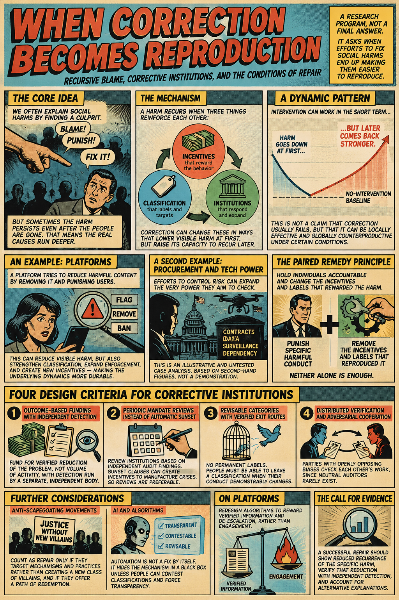

[When Correction Becomes Reproduction](https://standardgalactic.github.io/alignment/research/correction-reproduction.pdf)

* [Why the Cure Makes Problems Permanent](https://standardgalactic.github.io/alignment/research/) — *Audio Overview*

A mathematical analysis of corrective institutions, showing how systems created to remedy a problem can acquire incentives to preserve the conditions that sustain their authority, funding and activity. Drawing on institutional theory and formal models of incentives and feedback, it traces how correction becomes reproduction, and it separates accountability for individual conduct from reform of the structures that reward it.
<!--
[Perpetual Renovation Theorem](https://standardgalactic.github.io/alignment/research/perpetual_renovation_theorem.pdf)

[The Never-Ending Ticker](https://standardgalactic.github.io/alignment/research/never_ending_ticker.pdf)
-->

[The Abolition of the Button](https://standardgalactic.github.io/alignment/research/abolition-of-the-button.pdf)

A critique of brain-computer interfaces, arguing that replacing buttons and keyboards with neural decoding does not eliminate the work those interfaces performed in distinguishing commands, confirming intent, and correcting errors, but relocates it into systems that are harder to inspect and maintain. Drawing on information theory and decision theory, it examines claims of neural “immediacy,” while setting aside assistive medical applications.

